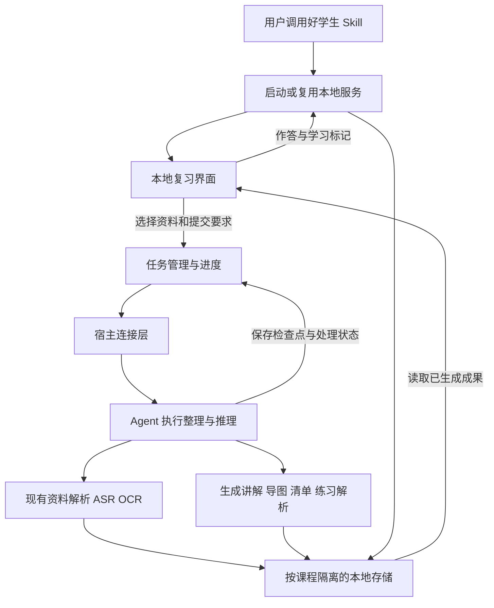

# 好学生 Agent 设计文档

版本：1.2 · 本地工作台与自动接单  
日期：2026 年 11 月 19 日  
状态：已接入本机登录的 Codex 后台执行器与界面授权；桌面外壳仍为后续扩展。

## 1. 这次要改什么

把主要使用方式改为：**调用好学生 → 打开本地界面 → 选择资料和模式 → 一次生成整套复习资料 → 在界面中自主复习。**

解决两个问题：聊天每次只讲一小段，需要反复说“继续”；内容散落在长对话里，难以查找。

聊天用于启动、提出新要求和针对性答疑。课程内容集中保存在本地工作台，用户可以直接选择任意章节，不必按聊天顺序逐题推进。

“一次生成完整”指一次发起任务后，完成本次选定范围内的所有约定模块。内部可以分章节、多次推理，不要求用户逐章催促。首次准备仍有耗时，之后阅读已有内容直接从本地加载。

## 2. 用户怎么使用

1. 用户在 Codex、DeepSeek harness 等宿主中说“用好学生帮我复习”。
2. Skill 启动本地服务，自动打开浏览器中的复习界面；已有服务则复用。
3. 用户选择课程、资料文件夹、可选录音或转写文件，以及高分／速通模式。聊天中已给出的路径和选择自动带入。
4. 点击“生成复习资料”，界面展示处理阶段、已完成章节和需要核对的文件。
5. Agent 连续完成整理、讲解、导图、重点清单、练习和解析并保存。不要求用户先答完某道题才能生成后续章节。
6. 生成完成后，用户自由阅读、搜索、练习和导出。关闭界面或换一个聊天，资料仍在。

首版的“弹出 UI”采用**本地浏览器页面**，地址仅监听本机。后续需要独立应用窗口时再增加桌面外壳，先复用同一套页面与服务。

### 界面模块

| 模块 | 用户看到什么 | 可以做什么 |
| --- | --- | --- |
| 资料与设置 | 课程、材料列表、录音、处理状态、复习模式 | 选择本机文件夹或文件、补充材料、修改目标 |
| 复习总览 | 本次资料范围、复习顺序、各章节准备状态 | 直接开始或跳到任意章节 |
| 知识脉络与导图 | 全科结构、章节导图、概念联系和必要前置知识 | 展开节点、跳转对应讲解、搜索知识点 |
| 重点与复习清单 | 老师明确会考、老师重点、用户重点，以及建议先学的基础内容，这部分用不同标记区分重要性 | 查看出处、添加用户重点、勾选复习状态 |
| 章节讲解 | 精华总结、概念条件、典型例题步骤、易错点 | 按章节阅读、标记不懂、提出具体问题 |
| 练习与解析 | 原题、AI 变式、答案和解析、错题 | 作答、展开解析、按知识点筛选、重做 |
| 学习记录与导出 | 已读、自评、实际作答、错题及复习包版本 | 继续上次位置、查看薄弱项、导出资料 |

页面采用左侧目录、右侧内容，顶部保留搜索和生成状态。每个模块都有独立入口和章节定位，不把整门课堆成一页长聊天。

文件路径通过本机选择器选取，也允许粘贴路径。选择资料文件夹后自动列出支持的文件，可排除无关文件；录音可为空。重复导入同一文件时复用已有结果。

## 3. 一次准备好的内容

### 完整复习包

每门课的一次生成包含：

- **课程结构**：全科目录、章节关系、课程总导图和章节分图。
- **知识讲解**：选定范围内各章节的精华总结、必要定义与条件、方法步骤、典型例题和易混点。
- **重点清单**：有来源的正式重点，与 Agent 建议的学习顺序分开展示。
- **复习安排**：按当前模式给出顺序、先学内容和可稍后补充的内容。
- **练习包**：整理选定资料里的原题，准备有来源的变式或知识点练习；每题提前保存答案与解析。
- **资料说明**：本次实际处理了哪些文件和章节，哪些页面、公式或录音片段仍需核对。

“完整”以生成前确定的资料范围和内容清单为准。范围默认包含选入的全部资料；大教材或长录音需要限定章节时，在开始前明确展示，不在处理中悄悄跳过。练习数量有限：默认每章补充 2 道基础题和 1 道应用题，按知识内容调整，并在任务清单中记录；不承诺生成无限题目。

**只有目录、原文预览或空模块不算完成。**正式重点可能确实为空，此时说明没有对应证据，并继续提供课程知识和建议复习清单。

### 阅读和答疑

生成的讲解与解析直接可读。练习答案默认折叠，用户主动展开即可查看，不必再等待模型生成。已看解析、使用提示、独立作答和自评分别记录。

用户说“我会了，继续”时允许直接跳过，并记为自评，不强制先测验，也不伪造答对记录。

针对性追问只取当前知识点、关联章节和相关原文提供给 Agent；补充回答保存到对应章节。不会每次重新处理整门课。

## 4. 总体架构

保留现有资料处理与存储能力，新增本地页面、任务管理和宿主连接层。



### 各层负责什么

| 层 | 职责 | 首版方案 |
| --- | --- | --- |
| Skill 入口 | 理解要求、恢复课程、启动界面、组织一次完整任务 | 沿用现有 good-student 主技能 |
| 本地界面 | 路径选择、目录、搜索、导图、阅读、练习和进度 | HTML/CSS/JavaScript；Markdown 与 Mermaid 在本地渲染 |
| 本地服务 | 页面资源、资料选择、内容读取、任务状态和学习记录写入 | Python + FastAPI，调用现有 StudentService |
| 任务管理 | 固定处理范围、拆分任务、记录检查点、重试和恢复 | 本地持久化任务清单，首版同一课程一次执行一个生成任务 |
| 宿主连接层 | 把待办任务交给实际可运行的 Agent，接收生成结果 | 复用本机已登录的 Codex CLI 自动接单；当前宿主也可接手 |
| 内容处理 | 文件解析、转写、OCR、知识关联、重点证据、题目与导出 | 复用现有 Python 模块，完善完整资料包生成 |
| 数据存储 | 原件、结构化记录、复习包、学习进度及历史版本 | 沿用课程 JSON 与文件目录，暂不引入数据库 |

这些都是 Agent 和界面内部使用的能力。用户无需导入源码、输入命令、填写课程编号或配置 Python 调用。

### 关键：谁来真正执行推理

本地页面和 Python 服务负责接收请求与保存结果，模型推理由实际执行器提供。当前已接入本机已登录的 Codex CLI，后台任务在沙箱中运行，不依赖当前聊天一直保持活跃，不读取或搬运凭据，也不需要用户填写新的 API 密钥。

首次提交时，界面列明要发送给 Codex（OpenAI）的课程资料及必要学习记录，用户点击“允许并开始”后自动接单。授权只记住本课程已确认的资料版本，新增或修改资料、换课程需要再次确认；支持撤销授权。任务连续执行到整套资料包完成或遇到真实阻塞，无需用户反复说“继续”。

Agent 被中断或会话结束时，任务保存检查点，界面显示“等待 Agent 继续”，不能一直假显示“正在生成”。任务记录执行器占用和最近活跃时间，失联超时后转为待恢复；恢复时校验占用，避免两个执行器重复处理。已有成果仍能阅读；用户再次调用 Skill 时从检查点接着做。

界面中后续提交的新生成、追问、开放题批改和答案质疑，都经同一入口交给执行器。未安装、未登录、额度不足或执行失败时，任务显示具体原因与可重试状态，不假装一直生成。其他 harness 可以使用统一队列接手，独立自动适配按实际能力接入。

浏览、搜索、导图展开、显示已有解析、客观题核对和学习标记均直接在本地完成。开放题的个性化批改需要推理，但预生成参考解析始终可看。

## 5. 生成任务怎么运行


1. **先列清单**：记录本次文件、章节、模式、卷面目标、需要生成的模块和练习数量。
2. **先处理资料**：识别文本、课件、扫描件和录音；保存页码、幻灯片编号或已有时间戳，记录实际覆盖范围。
3. **再建主线**：以课程资料建立完整目录，录音只补充对应章节。关联知识点、前置知识和题目出处。
4. **逐章生成并保存**：每章写入讲解、导图节点、重点、例题、练习和解析，完成后立即保存检查点。
5. **统一核对**：检查章节是否遗漏、正式重点是否有证据、题目是否完整、答案是否符合条件、模块是否确有内容。
6. **发布成果**：全任务和各章节分别标注完成情况；有失败或待核对项时标记“部分完成”，列明影响，保留其他可用成果。

内部按章节分批生成，用户只发起一次。已完成章节可以提前阅读，其他章节继续执行；不会把先出现的几章当作全科已完成。

### 减少等待和上下文占用

- 解析结果、录音转写、OCR 和已核对章节复用，不随页面点击重新处理。
- 首轮生成覆盖本次约定范围；章节分批只控制内部上下文大小，不把承诺生成的章节留到用户点击才写。
- 每批只读取全科结构、当前章节原文、相关重点与题目；用来源索引定位，不把全学期原文反复塞进对话。
- 目录搜索和关键词搜索使用本地索引；首版无需向量数据库。
- 补充资料后更新受影响章节及相关总览；切换模式时复用已解析材料和充分的讲解，调整安排及练习。速通切高分时补齐所需的深入讲解、推导和综合联系。
- 界面报告实际阶段和“已完成章节／总章节”，不承诺虚假的剩余时间或首次瞬间完成。

首次集中生成能减少后续反复推理，但总耗时仍随资料量、扫描质量和模型速度变化。

## 6. 保存、恢复与更新

沿用现有项目数据目录和课程编号，新增任务记录与复习包。原始学习资料只读导入，生成内容写在好学生项目空间。

```text
好学生agent/
  good_student/                  现有处理能力，后续增加界面服务和任务模块
  skills/good-student/           Skill 入口与宿主使用说明
  web/                          待新增的本地页面和离线资源
  data/courses/<课程编号>/
    state.json                  现有课程、重点、题目和学习记录
    sources/                    已归档的原始资料
    jobs/<任务编号>/             处理清单、阶段、错误和检查点
    packages/<复习包版本>/
      manifest.json             本次范围、模式、来源版本及模块完成状态
      overview.md               全科概览和复习安排
      outline.json              章节、知识点和跳转关系
      mindmap.mmd               总导图
      chapters/                 各章完整讲解、例题和分图
      focus.json                有来源的重点清单快照
      practice.json             题目、答案、解析和来源快照
      index.json                页面定位与本地搜索索引
    exports/                    可携带的资料导出
```

现有 `state.json` 继续作为课程与学习记录的统一来源；复习包是某次生成的内容快照，不反向覆盖用户的最新作答和标记。界面与 Agent 都通过同一服务写入，避免各存一份相互冲突的进度。

每个任务绑定明确的课程、输入资料版本和模式。重试只补失败或未完成部分，避免重复生成题目；运行中的任务基于固定输入，新增资料留给后续更新任务。

新复习包先在独立版本中构建，校验后更新当前版本指向；失败不会覆盖旧包。构建过程中提供只读的“本次生成预览”，仅展示已完成章节，与原正式包分开。稳定知识点与题目编号用于保留学习记录。内容或答案变化时标记需重新确认，不把旧题答对记录自动算作新题通过。

关闭浏览器不删除任务和成果。本地服务重启后恢复课程与任务状态；需要模型的步骤仍由实际可用的 Agent 执行器继续，不把“数据已恢复”误称为“推理已自动恢复”。

本地服务只监听本机，校验请求来源、会话凭据和课程文件路径。源资料中的文字按课程内容处理，不执行其指令。页面与导图资源随项目提供，阅读已生成资料不依赖外部 CDN。文件本地保存和 ASR/OCR 本地执行，不等于宿主模型推理一定离线；推理沿用所选宿主的实际方式。

## 7. 沿用的学习规则

- **高分模式**：覆盖选定范围的全部知识，讲解更充分，加强重点、综合练习和查漏。
- **速通模式**：以卷面及格为目标，百分制默认 60 分，也可自定及格线；给完整课程框架，优先讲清重点和必要基础，不计算平时分占比，不保证真实考试分数。
- **重点来源**：正式重点只有老师明确说会考／是重点，以及用户明确指定；三类分开展示并保留出处。“去年考过”、题目频繁出现、总结文档自称“必考”，都不能自动成为教师正式重点。
- **建议清单**：Agent 可以建议哪些基础先学，但显示为复习建议，不包装成教师重点或必考预测。
- **录音不齐也能用**：没有录音或只有部分课的录音，都以课件、教材或考试范围建立主线；没录到的章节不能据此排除。
- **输入方式**：保留手机录音、豆包逐字稿／纪要、PPT/PPTX、PDF、DOCX、文本和图片，复用现有转写与 OCR；图表、公式和识别不清的内容标明待核对。
- **题目与解析**：分成用户原题与 Agent 模拟题；资料已给的答案严格原样保留，缺答案时优先依据课程知识并附具体出处。用户质疑后另存复核版本，保留原答案与理由；资料不足时明确未确认。暂不分析或模仿教师命题风格。
- **学习记录**：阅读、自评、使用提示、看过解析和独立通过分别保存；自由跳章不会丢失资料或被误记为掌握。

## 8. 开发顺序与验收

### 开发顺序

1. **打通启动与执行**：Skill 打开本地页面，选择路径和模式后，任务能实际交给当前 Agent；核实宿主连接，不先做没有执行器的生成按钮。
2. **完成整包生成**：按章节连续生成全部模块，保存进度、来源和复习包版本，可在中断后继续。
3. **完成阅读与练习**：目录跳转、本地搜索、可展开导图、折叠解析、作答、错题和学习标记。
4. **完善更新与导出**：追加材料局部更新、模式切换、恢复和导出；再按需要接独立后台执行器与桌面外壳。

现有 ASR、OCR、文件解析、重点规则和课程存储继续复用。当前已接入本地页面、宿主任务桥接、完整资料包存储与导出，使用方式见项目主技能。

### 首版验收

| 场景 | 必须达到的结果 |
| --- | --- |
| 调用 Skill | 自动打开或复用本地界面，用户无需手动运行源码 |
| 无录音或部分录音 | 可直接生成复习包，保留完整课程主线与实际资料缺口 |
| 一次生成 | 所有约定章节与模块均有实质内容、来源和状态，不需反复说“继续” |
| 较长课程 | 内部分批处理，页面可读已完成章节，同时清楚显示全任务仍未完成 |
| 完成后浏览 | 切章节、搜索、展开导图、查看已有解析不触发模型 |
| 关闭后再打开 | 从本地恢复原复习包、阅读位置、作答和自评 |
| 中断或局部失败 | 保留成果与检查点，恢复后只补未完成部分，旧复习包仍可用 |
| 没有 Agent 执行器 | 准确显示“等待 Agent 继续”，不伪装成持续生成 |
| 补材料或切模式 | 复用已有解析，更新相关内容，保留学习记录与历史版本 |
| 完成一轮练习 | 可以查看提前保存的解析；独立作答与看过答案不混记 |
| 多门课程与导出 | 资料和进度互相隔离，导出 Markdown 与导图，范围及未完成项清楚可见 |

### 技术选型依据

本地页面由 Python 服务提供，默认浏览器由 [Python webbrowser](https://docs.python.org/3.12/library/webbrowser.html) 打开；本机文件与文件夹选择使用 [Python 文件对话框](https://docs.python.org/3.12/library/dialog.html)。长任务单独保留任务状态和检查点，不仅依赖一次 HTTP 请求或内存里的后台回调；[FastAPI 后台任务说明](https://fastapi.tiangolo.com/tutorial/background-tasks/)也提示重计算应考虑独立任务执行方式。以上为架构选型，实际接口和宿主适配在实施时验证。
